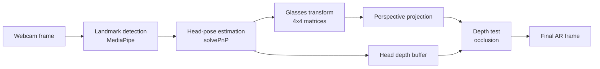

# Mirror

**Real-Time 3D Augmented Reality Virtual Eyewear Try-On**

Mirror tracks your face through a webcam and renders a 3D pair of glasses onto it in real time. It estimates where your head is and how it is turned, attaches a 3D glasses model to your face, projects it into the camera image with correct perspective, and hides the parts of the frame that should be behind your head.

Built in Python with **OpenCV**, **MediaPipe**, and **NumPy**. The 3D math, projection, and occlusion are implemented directly rather than through a game engine or graphics library.

> **Status:** working prototype, under active development.

## Features

- **Real-time facial landmark tracking** from a live webcam feed using MediaPipe Face Mesh.
- **3D head-pose estimation** with OpenCV `solvePnP`, using ten stable facial landmarks matched to MediaPipe's canonical 3D face model. Unreliable poses are rejected using a reprojection-error check.
- **Glasses that follow the head** through yaw, pitch, roll, and movement toward or away from the camera.
- **Perspective-correct 3D rendering** of a wireframe glasses model, with the arms receding toward the ears as you would expect.
- **Procedurally generated glasses geometry**: rounded lenses that wrap slightly around the face, a bridge, and temple arms that splay outward and bend down at the ear, all built from configurable real-world dimensions in centimetres.
- **Face-aware occlusion**: a depth buffer of the head is rasterized every frame, so the temple arms disappear behind the side of the head when you turn.
- **Modular accessory system**: the face tracking pipeline is separate from the accessory, so a different model only needs its own geometry and attachment calibration.
- **Debug and visualization tools**: on-screen readouts of yaw, pitch, roll, and translation, a face-aligned 3D axis overlay, and toggles for each rendering stage.

## Technologies

| Technology | Role in Mirror |
|---|---|
| **Python 3.11** | Application language |
| **MediaPipe** | Detects 478 facial landmarks per frame; its canonical face mesh is also used as the 3D face model for pose estimation and occlusion |
| **OpenCV** | Webcam capture, `solvePnP` head-pose estimation, `projectPoints` perspective projection, and drawing the final frame |
| **NumPy** | Vectorized matrix math, coordinate transforms, and the depth-buffer rasterizer |
| **uv** | Dependency management and reproducible environments (`uv.lock`) |

`jax` and `jaxlib` are pinned in `pyproject.toml` alongside MediaPipe but are not imported by Mirror's own code.

## How It Works

Each webcam frame goes through the same pipeline:



### 1. Facial tracking

The frame is mirrored, so it behaves like a mirror, and passed to MediaPipe Face Mesh. MediaPipe returns 478 landmarks, each a normalized (x, y) position on the face. Mirror converts these to pixel coordinates.

### 2. Head-pose estimation

To place a 3D object on the face, Mirror needs the head's **rotation** and **position** relative to the camera. It uses the classic Perspective-n-Point setup:

- **Known 3D points:** ten landmarks (eye corners, nose bridge, nose tip, nostrils, forehead) taken from MediaPipe's canonical 3D face model, in centimetres. The mouth, chin, and eyelids are left out on purpose because they move when you talk or blink.
- **Observed 2D points:** where those same landmarks appear in the current frame.
- **Camera model:** a pinhole camera with an estimated focal length, since webcams are not calibrated.

`cv2.solvePnP` finds the rotation and translation that best line up the 3D model with the 2D observations. Mirror then reprojects the model and rejects the pose if the average error is too large compared with the face's size on screen, which avoids drawing glasses on a bad estimate.

### 3. 3D transformations

The glasses pass through a chain of coordinate systems. Each step is a single 4×4 matrix:

```
glasses-local (cm)  --attachment-->  face-local (cm)  --head pose-->  camera (cm)  --projection-->  pixels
```

- The **attachment matrix** places the glasses on the face: anchored at the nose bridge, slightly lowered to sit level with the eyes, and pushed 0.5 cm forward so the frame does not pass through the nose. It never changes, so it is built once.
- The **head-pose matrix** comes from `solvePnP` and changes every frame.

Combining them gives one matrix that takes every glasses vertex straight into camera space.

### 4. Perspective projection

A point at camera coordinates (X, Y, Z) lands on screen at roughly

```
x = f · X / Z + cx
y = f · Y / Z + cy
```

where `f` is the focal length in pixels and (cx, cy) is the image centre. Dividing by depth `Z` is what makes the far ends of the temple arms appear smaller and closer together than the front of the frame. Points behind the camera are dropped rather than projected.

### 5. Facial occlusion

When you turn your head, the arm on the far side should disappear behind it. Mirror handles this with a small **depth buffer**:

1. MediaPipe's canonical face mesh (468 vertices, 898 triangles) covers only the front of the face, so Mirror extends it backward into an approximate head shape that reaches past the ears.
2. Each frame, that head mesh is moved into camera space with the same head pose as the glasses, then rasterized into a reduced-resolution depth buffer. Each pixel stores the distance to the nearest head surface. Depth is interpolated perspective-correctly (1/Z is linear across the screen, Z is not).
3. Each glasses edge is sampled every 2.5 mm in 3D. A sample is drawn only if it is not behind the head surface at its pixel, with a small tolerance for parts that rest on the skin.

The rasterizer is written in NumPy and processes all triangles at once instead of looping in Python.

## Architecture

```
Mirror/
├── main.py                  # App loop: camera, tracking, rendering, keyboard controls
├── geometry.py              # 2D helpers: distance, midpoint, tilt, 2D transforms
├── glasses.py               # Simple 2D glasses overlay
├── head_pose.py             # solvePnP head pose, camera model, Euler angles, axis overlay
├── accessory_transform.py   # Attachment matrices and 3D -> pixel projection for any accessory
├── glasses_3d.py            # Procedural 3D glasses model and wireframe renderer
├── occlusion.py             # Head proxy mesh, depth-buffer rasterizer, visibility tests
├── face_landmarker.task     # MediaPipe model bundle (source of the canonical face mesh)
├── tests/                   # Unit and integration tests
├── pyproject.toml
└── uv.lock
```

The modules are layered so each stage can change on its own:

| Concern | Module |
|---|---|
| Camera processing and app loop | `main.py` |
| Facial tracking | MediaPipe, called from `main.py` |
| Geometry | `geometry.py` |
| Head pose | `head_pose.py` |
| Accessory transformations | `accessory_transform.py` |
| Glasses rendering | `glasses_3d.py` (3D), `glasses.py` (2D) |
| Occlusion | `occlusion.py` |
| Testing | `tests/` |

`accessory_transform.py` knows nothing about glasses specifically. A new accessory supplies its vertices, edges, units, orientation, and attachment offset, and reuses the same tracking, projection, and occlusion code.

## Installation and Usage

**Requirements:** Python 3.11+, [uv](https://docs.astral.sh/uv/), and a webcam.

```bash
git clone https://github.com/mattjlourens-ctrl/Mirror.git
cd Mirror
uv sync
uv run python main.py
```

A window titled **Mirror** opens with the camera feed. The app starts with the 2D overlay; press **H** to turn on the 3D glasses.

**Camera permissions:** on macOS, the first run asks for camera access for your terminal or IDE. If the window never appears, enable it under *System Settings → Privacy & Security → Camera* and run the app again. Mirror opens the default camera (index 0).

**To exit,** press **Q** with the Mirror window focused.

## Keyboard Controls

| Key | Action | Default |
|---|---|---|
| `H` | Toggle 3D wireframe glasses | Off |
| `G` | Toggle 2D glasses overlay | On |
| `O` | Toggle occlusion of 3D glasses behind the head | On |
| `P` | Toggle 3D face axes (X red, Y green, Z blue) | Off |
| `D` | Toggle debug panel (landmarks, tilt, yaw/pitch/roll, translation) | Off |
| `Q` | Quit | |

## Testing

Mirror has unit tests for the math and rendering stages, plus an integration test that runs the real `main.py` loop with a fake camera, fake key presses, and synthetic MediaPipe landmarks, so the whole app can be checked without a webcam.

```bash
uv run python -m unittest discover -s tests -v
```

Current result: **103 tests, all passing.** They cover:

- 2D geometry and transforms
- Head-pose recovery from synthetic faces, reprojection-error rejection, and Euler-angle signs
- Glasses model construction, dimension validation, and projection
- Depth-buffer rasterization, visibility, and line clipping at occluder edges and the near plane
- The full app loop and every keyboard toggle

## Current Limitations

- **Approximate camera calibration.** The focal length is estimated from the frame width, so depth and translation values are approximate.
- **Generic face model.** Pose is solved against MediaPipe's average face, so fit varies with individual face shape.
- **Procedural glasses only.** There is one programmatically generated wireframe model; textured or imported models are not supported yet.
- **No smoothing.** Pose is estimated independently each frame, so some jitter is visible during movement.
- **Approximate occlusion.** The head behind the face is a simple proxy with no ears or hair, so occlusion can be off around the ears, at extreme head turns, or with large hairstyles.
- **Single face, local only.** Tracks one face at a time and runs as a desktop window rather than in a browser.

## Roadmap

Planned work, not yet implemented:

- Photo-based glasses recognition and 3D reconstruction in Python
- Procedural mesh generation from detected glasses contours
- Importing external 3D eyewear models (e.g. `.glb` / `.obj`)
- More realistic frame materials and lens rendering
- Tracking stabilization and smoothing
- A glasses catalog and selection interface

## Project Status

Mirror is an active, functional prototype built to explore real-time computer vision, 3D graphics, augmented reality, and software engineering practices such as modular design and automated testing.
