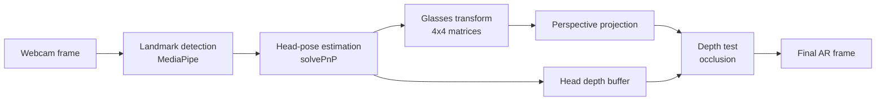

# Mirror

**Real-Time 3D Augmented Reality Virtual Eyewear Try-On**

Mirror tracks your face through a webcam and renders a 3D pair of glasses onto it in real time. It estimates where your head is and how it is turned, attaches a 3D glasses model to your face, projects it into the camera image with correct perspective, and hides the parts of the frame that should be behind your head.

Built in Python with **OpenCV**, **MediaPipe**, and **NumPy**. The 3D math, projection, and occlusion are implemented directly rather than through a game engine or graphics library.

> **Status:** working prototype, under active development.

## Features

- **Real-time facial landmark tracking** from a live webcam feed using MediaPipe Face Mesh.
- **3D head-pose estimation** with OpenCV `solvePnP`, using ten stable facial landmarks matched to MediaPipe's canonical 3D face model. Unreliable poses are rejected using a reprojection-error check.
- **Glasses that follow the head** through yaw, pitch, roll, and movement toward or away from the camera.
- **Perspective-correct 3D rendering** of a wireframe glasses model, with the arms receding toward the ears as you would expect.
- **Procedurally generated glasses geometry**: rounded lenses that wrap slightly around the face, a bridge, and temple arms that splay outward and bend down at the ear, all built from configurable real-world dimensions in centimetres.
- **Face-aware occlusion**: a depth buffer of the head is rasterized every frame, so the temple arms disappear behind the side of the head when you turn.
- **Modular accessory system**: the face tracking pipeline is separate from the accessory, so a different model only needs its own geometry and attachment calibration.
- **Debug and visualization tools**: on-screen readouts of yaw, pitch, roll, and translation, a face-aligned 3D axis overlay, and toggles for each rendering stage.

## Technologies

| Technology | Role in Mirror |
|---|---|
| **Python 3.11** | Application language |
| **MediaPipe** | Detects 478 facial landmarks per frame; its canonical face mesh is also used as the 3D face model for pose estimation and occlusion |
| **OpenCV** | Webcam capture, `solvePnP` head-pose estimation, `projectPoints` perspective projection, and drawing the final frame |
| **NumPy** | Vectorized matrix math, coordinate transforms, and the depth-buffer rasterizer |
| **uv** | Dependency management and reproducible environments (`uv.lock`) |

`jax` and `jaxlib` are pinned in `pyproject.toml` alongside MediaPipe but are not imported by Mirror's own code.

## How It Works

Each webcam frame goes through the same pipeline:



### 1. Facial tracking

The frame is mirrored, so it behaves like a mirror, and passed to MediaPipe Face Mesh. MediaPipe returns 478 landmarks, each a normalized (x, y) position on the face. Mirror converts these to pixel coordinates.

### 2. Head-pose estimation

To place a 3D object on the face, Mirror needs the head's **rotation** and **position** relative to the camera. It uses the classic Perspective-n-Point setup:

- **Known 3D points:** ten landmarks (eye corners, nose bridge, nose tip, nostrils, forehead) taken from MediaPipe's canonical 3D face model, in centimetres. The mouth, chin, and eyelids are left out on purpose because they move when you talk or blink.
- **Observed 2D points:** where those same landmarks appear in the current frame.
- **Camera model:** a pinhole camera with an estimated focal length, since webcams are not calibrated.

`cv2.solvePnP` finds the rotation and translation that best line up the 3D model with the 2D observations. Mirror then reprojects the model and rejects the pose if the average error is too large compared with the face's size on screen, which avoids drawing glasses on a bad estimate.

### 3. 3D transformations

The glasses pass through a chain of coordinate systems. Each step is a single 4×4 matrix:

```
glasses-local (cm)  --attachment-->  face-local (cm)  --head pose-->  camera (cm)  --projection-->  pixels
```

- The **attachment matrix** places the glasses on the face: anchored at the nose bridge, slightly lowered to sit level with the eyes, and pushed 0.5 cm forward so the frame does not pass through the nose. It never changes, so it is built once.
- The **head-pose matrix** comes from `solvePnP` and changes every frame.

Combining them gives one matrix that takes every glasses vertex straight into camera space.

### 4. Perspective projection

A point at camera coordinates (X, Y, Z) lands on screen at roughly

```
x = f · X / Z + cx
y = f · Y / Z + cy
```

where `f` is the focal length in pixels and (cx, cy) is the image centre. Dividing by depth `Z` is what makes the far ends of the temple arms appear smaller and closer together than the front of the frame. Points behind the camera are dropped rather than projected.

### 5. Facial occlusion

When you turn your head, the arm on the far side should disappear behind it. Mirror handles this with a small **depth buffer**:

1. MediaPipe's canonical face mesh (468 vertices, 898 triangles) covers only the front of the face, so Mirror extends it backward into an approximate head shape that reaches past the ears.
2. Each frame, that head mesh is moved into camera space with the same head pose as the glasses, then rasterized into a reduced-resolution depth buffer. Each pixel stores the distance to the nearest head surface. Depth is interpolated perspective-correctly (1/Z is linear across the screen, Z is not).
3. Each glasses edge is sampled every 2.5 mm in 3D. A sample is drawn only if it is not behind the head surface at its pixel, with a small tolerance for parts that rest on the skin.

The rasterizer is written in NumPy and processes all triangles at once instead of looping in Python.

## Architecture

```
Mirror/
├── main.py                  # App loop: camera, tracking, rendering, keyboard controls
├── geometry.py              # 2D helpers: distance, midpoint, tilt, 2D transforms
├── glasses.py               # Simple 2D glasses overlay
├── head_pose.py             # solvePnP head pose, camera model, Euler angles, axis overlay
├── accessory_transform.py   # Attachment matrices and 3D -> pixel projection for any accessory
├── glasses_3d.py            # Procedural 3D glasses model and wireframe renderer
├── occlusion.py             # Head proxy mesh, depth-buffer rasterizer, visibility tests
├── face_landmarker.task     # MediaPipe model bundle (source of the canonical face mesh)
├── image_to_3d/             # Standalone: glasses image -> approximate 3D .glb (not used by main.py yet)
├── tests/                   # Unit and integration tests
├── pyproject.toml
└── uv.lock
```

The modules are layered so each stage can change on its own:

| Concern | Module |
|---|---|
| Camera processing and app loop | `main.py` |
| Facial tracking | MediaPipe, called from `main.py` |
| Geometry | `geometry.py` |
| Head pose | `head_pose.py` |
| Accessory transformations | `accessory_transform.py` |
| Glasses rendering | `glasses_3d.py` (3D), `glasses.py` (2D) |
| Occlusion | `occlusion.py` |
| Testing | `tests/` |

`accessory_transform.py` knows nothing about glasses specifically. A new accessory supplies its vertices, edges, units, orientation, and attachment offset, and reuses the same tracking, projection, and occlusion code.

## Installation and Usage

**Requirements:** Python 3.11+, [uv](https://docs.astral.sh/uv/), and a webcam.

```bash
git clone https://github.com/mattjlourens-ctrl/Mirror.git
cd Mirror
uv sync
uv run python main.py
```

A window titled **Mirror** opens with the camera feed. The app starts with the 2D overlay; press **H** to turn on the 3D glasses.

**Camera permissions:** on macOS, the first run asks for camera access for your terminal or IDE. If the window never appears, enable it under *System Settings → Privacy & Security → Camera* and run the app again. Mirror opens the default camera (index 0).

**To exit,** press **Q** with the Mirror window focused.

## Image to 3D

`image_to_3d` turns a front-facing PNG or JPG of glasses on a white or transparent background into a 3D model. It is separate from the AR pipeline: neither imports the other, and `main.py` does not load these models yet.

All geometry comes from deterministic mathematics and classical image processing, with no machine learning, depth estimation, or external services. The same image and parameters produce a byte-identical file.

> **This is an approximation, not a reconstruction.** One frontal photo says nothing reliable about depth or anything hidden behind the frame, so most of the 3D shape is estimated from parameters.

### What comes from where

| Part | Source |
|---|---|
| Frame outline and lens openings | **The photo** |
| Hinge and nose-pad positions, and the bridge when the frame has one | **The photo**, estimated from the outline |
| Overall size | **You** (`--frame-width`); one image has no absolute scale |
| Frame depth and wrap curvature | **Procedural** |
| Temple arms, hinge shapes, nose-pad shapes | **Procedural** |
| Bridge, if the outline has none joining the rims | **Procedural** |
| Colour and materials | **Fixed placeholders**, not taken from the photo |

### Usage

```bash
# Original shallow front frame only (still the default)
uv run python image_to_3d/mirror_image_to_3d.py glasses.png -o glasses.glb

# Complete model
uv run python image_to_3d/mirror_image_to_3d.py glasses.png --complete -o model.glb

# Adjusted model with nose pads and a shorter left arm
uv run python image_to_3d/mirror_image_to_3d.py glasses.png --complete --nose-pads \
    --frame-width 13.5 --frame-curvature 0.8 --temple-length 14.5 --left-temple-length 14

# Flat front with straight temples, from a generated sample image
uv run python image_to_3d/mirror_image_to_3d.py --demo --complete -o flat.glb \
    --frame-curvature 0 --temple-curvature 0 --temple-splay 0 --temple-ear-drop 0
```

### Parameters

Lengths are in centimetres. Values are validated, and bad ones exit with an error without writing a file. The `--complete` group is rejected without `--complete`.

| Option | Default | Meaning |
|---|---|---|
| `--frame-width` | 14.0 | Frame width, outer edge to outer edge. Excludes the temples' splay |
| `--frame-thickness`, `--thickness` | 0.4 | Front to rear depth along Z |
| `--white-threshold` | 240 | Pixels with every channel at or above this are background. With `--complete` and no explicit value, it adapts downward to halfway between the frame and white |
| `--alpha-threshold` | 200 | Pixels with alpha below this are background |
| `--complete` | off | Build the full model |
| `--frame-curvature` | 0.5 | How far the outer edges sit behind the centre, up to a quarter of the frame width |
| `--temple-length` | 14.0 | Measured along the arm from hinge to tip, like the size printed on real temples |
| `--temple-width` | 0.55 | Arm height |
| `--temple-thickness` | 0.25 | Arm depth, across its side |
| `--temple-splay` | 1.6 | Outward offset at the ear bend. The default clears Mirror's head proxy, which is wider than a 14 cm frame, so arms show past the frame from the front |
| `--temple-curvature` | 0.4 | How far the tip curves back in from the ear bend |
| `--temple-ear-drop` | 1.5 | How far the tip falls below the hinge |
| `--left-temple-*`, `--right-temple-*` | | Override any temple option for one arm. Left and right mean screen-left and screen-right, as elsewhere in Mirror |
| `--nose-pads` | off | Add separate nose pads. Off by default because many frames, such as moulded acetate, have none |
| `--opening-cleanup` | 0.04 | Remove strips narrower than this fraction of the frame width from lens openings; 0 disables |

### How each part is built

- **Silhouette.** The mask comes from OpenCV segmentation, then `findContours` traces outer edges and holes into polygons. For complete models, each opening is morphologically closed on its own, which removes thin strips bounded by that opening on both sides (typically the real temples seen through the lens) but cannot erode a rim, because a rim's far side isn't part of the opening.
- **Curved front.** The outline is extruded with constrained Delaunay caps, which avoid the zero-area triangles that pixel-aligned outlines can otherwise produce, then sheared along Z only: `(x, y, z) -> (x, y, z + f(x))`, with `f(x) = -depth * (x / half_width)^2`, the curve `glasses_3d.py` already uses. A shear keeps X and Y, so the front view is still the traced outline. It is also one-to-one, so it can't create self-intersections. Since meshes only bend at vertices, faces are first split at evenly spaced planes of constant X. A chord of width `w` on `z = -a x^2` sags `a w^2 / 4` wherever it is, so the spacing follows directly from a 0.05 mm tolerance, and a flat frame gets no extra faces.
- **Temples.** The centreline is two cubic Béziers sharing a tangent at the ear bend. The first stays level; the second drops and curves inward. Scaling the reach by fixed-point iteration makes the arc length match `--temple-length`. Adaptive de Casteljau subdivision keeps only the points the curve needs, so a straight arm is just two rings. A rounded-rectangle section is swept along it using rotation-minimising frames, so it doesn't twist. The left arm is the mirror image of the right.
- **Hinges.** The anchor is at mid-height of the frame's outermost 2.5%, moved onto frame material if needed. A vertical cylinder sits behind the frame, and a box along the local surface normal joins them, reaching into the frame.
- **Nose supports.** By default the nose rests on the bridge from the photo. If the rims aren't joined, a Bézier bar is generated between them. Optional pads are flattened ellipsoids on short arms, anchored on the rim on the nasal side of each opening and below its centre.

### Assembly and validation

The GLB has one named node per part: `front_frame`, `left_temple`, `right_temple`, `left_hinge`, `right_hinge`, and optionally `bridge`, `left_nose_pad`, `right_nose_pad`. It is an assembly of closed shells that deliberately overlap at joints, not one watertight solid.

Before anything is written, each part is checked for non-finite vertices, degenerate triangles, non-manifold edges, inconsistent winding, and inward normals. Parts meant to touch must touch, all other pairs must not intersect, and the frame and temples must not intersect themselves. Any failure stops the export. The intersection test checks for surfaces crossing, so overlaps that are only coplanar, or a part entirely inside another, aren't detected.

### Coordinates and connecting to the face tracker

Models use the accessory-local axes from `glasses_3d.py` and `head_pose.py`. Conveniently these match glTF, so no axis conversion is needed:

- **Origin:** centre of the frame's front view, on the front surface at `x = 0`
- **X:** towards the screen-right lens. **Y:** up. **Z:** forward, away from the face, so the temples run towards -Z
- **Units:** centimetres in memory, metres in the GLB, as glTF specifies

Nothing in the live app uses these files yet. A future loader would read the GLB with Trimesh and use the existing transforms unchanged:

```python
attach = attachment_matrix(DEFAULT_GLASSES_ATTACHMENT, units_to_cm=100.0)
pixels = project_accessory(vertices_in_metres, attach, pose)
```

The tests already run exported geometry through `attachment_matrix`, `transform_points`, and `projected_segments`. To display it, the app would also need either a wireframe built from the mesh edges or a triangle renderer. The attachment offset was calibrated for the procedural wireframe, so photo-based frames may need their own.

### Modules

| Module | Responsibility |
|---|---|
| `segmentation.py` | Load images, separate the frame from the background, clean up openings |
| `mesh.py` | Trace polygons, scale to centimetres, flat extrusion, GLB writing |
| `curvature.py` | Wrap curve, face splitting, curved front frame |
| `sweep.py` | Bézier evaluation and flattening, swept tubes |
| `temples.py` | Temple parameters, centreline, arm mesh |
| `hinges.py` | Hinge and nose anchors, hinge, nose pad, and fallback bridge geometry |
| `validation.py` | Topology checks and intersection tests |
| `assembly.py` | Parameters, assembling components, export |
| `pipeline.py` | Image-to-GLB conversions |
| `mirror_image_to_3d.py` | Command line |

### Limitations and assumptions

- **Temple shape and length are defaults,** not measurements. Even the photographed temples are discarded when they show through the lenses.
- **The front is a uniform-thickness sheet** with square edges. It has no rounded rims, bevels, or variation in thickness, and the wrap is one assumed curve.
- **Hinges and pads are simplified stand-ins,** and hinge height is inferred from the outline's end piece, which can be wrong on unusual shapes.
- **The photo must be frontal.** Tilt and perspective are baked into the outline.
- **Lenses aren't modelled.** Dark or opaque lenses become solid; the tool warns when it finds no openings.
- **Opening cleanup can remove real detail** narrower than the threshold, such as a decorative strip or a nose-pad arm, and can't remove an arm that crosses the whole opening.
- **Backgrounds must be white or transparent.** Heavy shadows may still count as frame, and white frames on white can't be separated.
- **Default temples flare outward** to clear the head proxy, so they look wider than real arms that flex around a head.
- **Faces render flat-shaded** because no smooth normals are exported, so facets on the curved front may be visible.

## Keyboard Controls

| Key | Action | Default |
|---|---|---|
| `H` | Toggle 3D wireframe glasses | Off |
| `G` | Toggle 2D glasses overlay | On |
| `O` | Toggle occlusion of 3D glasses behind the head | On |
| `P` | Toggle 3D face axes (X red, Y green, Z blue) | Off |
| `D` | Toggle debug panel (landmarks, tilt, yaw/pitch/roll, translation) | Off |
| `Q` | Quit | |

## Testing

Mirror has unit tests for the math and rendering stages, plus an integration test that runs the real `main.py` loop with a fake camera, fake key presses, and synthetic MediaPipe landmarks, so the whole app can be checked without a webcam.

```bash
uv run python -m unittest discover -s tests -v
```

Current result: **349 tests, all passing.** They cover:

- 2D geometry and transforms
- Head-pose recovery from synthetic faces, reprojection-error rejection, and Euler-angle signs
- Glasses model construction, dimension validation, and projection
- Depth-buffer rasterization, visibility, and line clipping at occluder edges and the near plane
- Image-to-3D: image loading failures, segmentation, wrap curvature, temples, hinges, nose supports, mesh topology, GLB export and reload, determinism, compatibility with Mirror's transforms, and the command line
- The full app loop and every keyboard toggle

## Current Limitations

- **Approximate camera calibration.** The focal length is estimated from the frame width, so depth and translation values are approximate.
- **Generic face model.** Pose is solved against MediaPipe's average face, so fit varies with individual face shape.
- **Procedural glasses only.** There is one programmatically generated wireframe model; textured or imported models are not supported yet.
- **No smoothing.** Pose is estimated independently each frame, so some jitter is visible during movement.
- **Approximate occlusion.** The head behind the face is a simple proxy with no ears or hair, so occlusion can be off around the ears, at extreme head turns, or with large hairstyles.
- **Single face, local only.** Tracks one face at a time and runs as a desktop window rather than in a browser.

## Roadmap

Planned work, not yet implemented:

- Loading `image_to_3d` models in the live app, with per-model calibration
- Importing external 3D eyewear models (e.g. `.glb` / `.obj`)
- More realistic frame materials and lens rendering
- Tracking stabilization and smoothing
- A glasses catalog and selection interface

## Project Status

Mirror is an active, functional prototype built to explore real-time computer vision, 3D graphics, augmented reality, and software engineering practices such as modular design and automated testing.
