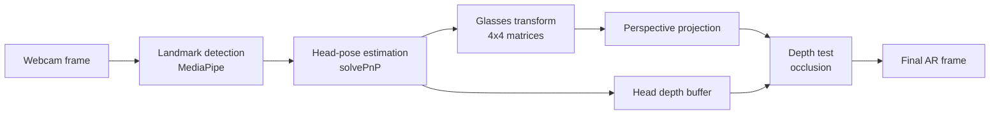

# Mirror

**Real-Time 3D Augmented Reality Virtual Eyewear Try-On**

Mirror tracks your face through a webcam and renders a 3D pair of glasses onto it in real time. It estimates where your head is and how it is turned, attaches a 3D glasses model to your face, projects it into the camera image with correct perspective, and hides the parts of the frame that should be behind your head.

Built in Python with **OpenCV**, **MediaPipe**, and **NumPy**. The 3D math, projection, and occlusion are implemented directly rather than through a game engine or graphics library.

> **Status:** working prototype, under active development.

## Features

- **Real-time facial landmark tracking** from a live webcam feed using MediaPipe Face Mesh.
- **3D head-pose estimation** with OpenCV `solvePnP`, using ten stable facial landmarks matched to MediaPipe's canonical 3D face model. Unreliable poses are rejected using a reprojection-error check.
- **Glasses that follow the head** through yaw, pitch, roll, and movement toward or away from the camera.
- **Perspective-correct 3D rendering** of a wireframe glasses model, with the arms receding toward the ears as you would expect.
- **Procedurally generated glasses geometry**: rounded lenses that wrap slightly around the face, a bridge, and temple arms that splay outward and bend down at the ear, all built from configurable real-world dimensions in centimetres.
- **Generated 3D glasses on your face**: load a `.glb` from `image_to_3d` and see filled, shaded glasses with depth testing, using the same tracking and transforms as the wireframe. Fit can be adjusted while running.
- **The product photo's appearance on the model**: the front of the frame is textured with the photo itself, and the unseen sides, temples and hinges get colours estimated from it. The texture is embedded in the `.glb`.
- **Face-aware occlusion**: a depth buffer of the head is rasterized every frame, so the temple arms disappear behind the side of the head when you turn.
- **Modular accessory system**: the face tracking pipeline is separate from the accessory, so a different model only needs its own geometry and attachment calibration.
- **Debug and visualization tools**: on-screen readouts of yaw, pitch, roll, and translation, a face-aligned 3D axis overlay, and toggles for each rendering stage.

## Technologies

| Technology | Role in Mirror |
|---|---|
| **Python 3.11** | Application language |
| **MediaPipe** | Detects 478 facial landmarks per frame; its canonical face mesh is also used as the 3D face model for pose estimation and occlusion |
| **OpenCV** | Webcam capture, `solvePnP` head-pose estimation, `projectPoints` perspective projection, and drawing the final frame |
| **NumPy** | Vectorized matrix math, coordinate transforms, and the depth-buffer rasterizer |
| **uv** | Dependency management and reproducible environments (`uv.lock`) |

`jax` and `jaxlib` are pinned in `pyproject.toml` alongside MediaPipe but are not imported by Mirror's own code.

## How It Works

Each webcam frame goes through the same pipeline:



### 1. Facial tracking

The frame is mirrored, so it behaves like a mirror, and passed to MediaPipe Face Mesh. MediaPipe returns 478 landmarks, each a normalized (x, y) position on the face. Mirror converts these to pixel coordinates.

### 2. Head-pose estimation

To place a 3D object on the face, Mirror needs the head's **rotation** and **position** relative to the camera. It uses the classic Perspective-n-Point setup:

- **Known 3D points:** ten landmarks (eye corners, nose bridge, nose tip, nostrils, forehead) taken from MediaPipe's canonical 3D face model, in centimetres. The mouth, chin, and eyelids are left out on purpose because they move when you talk or blink.
- **Observed 2D points:** where those same landmarks appear in the current frame.
- **Camera model:** a pinhole camera with an estimated focal length, since webcams are not calibrated.

`cv2.solvePnP` finds the rotation and translation that best line up the 3D model with the 2D observations. Mirror then reprojects the model and rejects the pose if the average error is too large compared with the face's size on screen, which avoids drawing glasses on a bad estimate.

### 3. 3D transformations

The glasses pass through a chain of coordinate systems. Each step is a single 4×4 matrix:

```
glasses-local (cm)  --attachment-->  face-local (cm)  --head pose-->  camera (cm)  --projection-->  pixels
```

- The **attachment matrix** places the glasses on the face: anchored at the nose bridge, slightly lowered to sit level with the eyes, and pushed 0.5 cm forward so the frame does not pass through the nose. It never changes, so it is built once.
- The **head-pose matrix** comes from `solvePnP` and changes every frame.

Combining them gives one matrix that takes every glasses vertex straight into camera space.

### 4. Perspective projection

A point at camera coordinates (X, Y, Z) lands on screen at roughly

```
x = f · X / Z + cx
y = f · Y / Z + cy
```

where `f` is the focal length in pixels and (cx, cy) is the image centre. Dividing by depth `Z` is what makes the far ends of the temple arms appear smaller and closer together than the front of the frame. Points behind the camera are dropped rather than projected.

### 5. Facial occlusion

When you turn your head, the arm on the far side should disappear behind it. Mirror handles this with a small **depth buffer**:

1. MediaPipe's canonical face mesh (468 vertices, 898 triangles) covers only the front of the face, so Mirror extends it backward into an approximate head shape that reaches past the ears.
2. Each frame, that head mesh is moved into camera space with the same head pose as the glasses, then rasterized into a reduced-resolution depth buffer. Each pixel stores the distance to the nearest head surface. Depth is interpolated perspective-correctly (1/Z is linear across the screen, Z is not).
3. Each glasses edge is sampled every 2.5 mm in 3D. A sample is drawn only if it is not behind the head surface at its pixel, with a small tolerance for parts that rest on the skin.

The rasterizer is written in NumPy and processes all triangles at once instead of looping in Python.

Generated models use the same head depth buffer, tested per pixel rather than per sample. See [Live 3D Try-On](#live-3d-try-on).

## Architecture

```
Mirror/
├── main.py                  # App loop: camera, tracking, rendering, keyboard controls
├── geometry.py              # 2D helpers: distance, midpoint, tilt, 2D transforms
├── glasses.py               # Simple 2D glasses overlay
├── head_pose.py             # solvePnP head pose, camera model, Euler angles, axis overlay
├── accessory_transform.py   # Attachment matrices and 3D -> pixel projection for any accessory
├── glasses_3d.py            # Procedural 3D glasses model and wireframe renderer
├── occlusion.py             # Head proxy mesh, depth-buffer rasterizer, visibility tests
├── glb_model.py             # Load and cache generated .glb glasses for rendering
├── mesh_renderer.py         # Filled, shaded triangle renderer with depth and near-plane clipping
├── fit_controls.py          # Live fit adjustments: scale, position, rotation
├── validate_appearance.py   # Renders a generated model beside its photo and measures the match
├── face_landmarker.task     # MediaPipe model bundle (source of the canonical face mesh)
├── image_to_3d/             # Standalone: glasses image -> approximate 3D .glb (imports nothing from the app)
├── tests/                   # Unit and integration tests
├── pyproject.toml
└── uv.lock
```

The modules are layered so each stage can change on its own:

| Concern | Module |
|---|---|
| Camera processing and app loop | `main.py` |
| Facial tracking | MediaPipe, called from `main.py` |
| Geometry | `geometry.py` |
| Head pose | `head_pose.py` |
| Accessory transformations | `accessory_transform.py` |
| Glasses rendering | `mesh_renderer.py` (generated model), `glasses_3d.py` (wireframe), `glasses.py` (2D) |
| Model loading and fit | `glb_model.py`, `fit_controls.py` |
| Occlusion | `occlusion.py` |
| Testing | `tests/` |

`accessory_transform.py` knows nothing about glasses specifically. A new accessory supplies its vertices, edges, units, orientation, and attachment offset, and reuses the same tracking, projection, and occlusion code.

## Installation and Usage

**Requirements:** Python 3.11+, [uv](https://docs.astral.sh/uv/), and a webcam.

```bash
git clone https://github.com/mattjlourens-ctrl/Mirror.git
cd Mirror
uv sync
uv run python main.py
```

A window titled **Mirror** opens with the camera feed. The app starts with the 2D overlay; press **H** to turn on the 3D glasses.

**Camera permissions:** on macOS, the first run asks for camera access for your terminal or IDE. If the window never appears, enable it under *System Settings → Privacy & Security → Camera* and run the app again. Mirror opens the default camera (index 0).

**To exit,** press **Q** with the Mirror window focused.

To try on a generated model, see [Live 3D Try-On](#live-3d-try-on).

## Live 3D Try-On

Generate a model once, then start Mirror with it:

```bash
uv run python image_to_3d/mirror_image_to_3d.py image_to_3d/glasses.jpg --complete -o image_to_3d/output/example_3_photo.glb
uv run python main.py --model image_to_3d/output/example_3_photo.glb
```

Complete models are textured from the photo by default. Add `--no-texture` when generating for the plain, fixed materials.

**M** switches between the generated model and the wireframe. Without `--model`, the app starts as usual and **M** loads `image_to_3d/output/example_3_photo.glb`. A missing or invalid file prints the reason and falls back to the wireframe.

### Adjusting the fit

Fit keys work while the app runs and never change the model's mesh. Press **F** to print the flags that reproduce the current fit, such as `--fit-scale 1.05 --fit-y -0.3`, and pass them next time. **D** shows the fit, the frame size, and the measured frame rate.

| Keys | Adjustment | Step | Limit |
|---|---|---|---|
| `J` / `L` | Left / right | 1 mm | ±5 cm |
| `I` / `K` | Up / down | 1 mm | ±5 cm |
| `U` / `N` | Forward / back | 1 mm | ±5 cm |
| `+` / `-` | Larger / smaller | 1% | 50% to 200% |
| `[` / `]` | Yaw | 1° | ±30° |
| `;` / `'` | Pitch | 1° | ±30° |
| `,` / `.` | Roll | 1° | ±30° |
| `R` | Reset the fit | | |

### How it renders

`glb_model.py` reads each named part (front frame, temples, hinges, nose pads) with its material, and converts metres to centimetres. A file is parsed once, and its per-face render arrays are built once, while loading.

Each frame, `mesh_renderer.py` moves the model through the same matrices as the wireframe, clips triangles at the near plane, culls those facing away, and rasterizes the rest with the rasterizer from `occlusion.py`. It then discards pixels behind the head, shades only the pixels that remain, softens the edges, and blends the result into the frame.

**Textures.** Texture coordinates are interpolated perspective-correctly, with the same depth-weighted interpolation the renderer uses for normals, so the photo stays fixed to the frame as the head turns rather than sliding across it. Near-plane clipping interpolates them along cut edges like normals. Each texture is stored once at load as a pyramid of successively halved copies. Every frame, the renderer picks the level where one texel covers about one pixel and blends the two nearest levels, so fine patterns average out instead of sparkling when the glasses are small. The texture is multiplied by the lighting, which is set so a surface facing the camera keeps the photo's colours. Textured parts get a weak highlight, because the photo already contains its own. A model wider than 420 pixels on screen is rasterized at that width and scaled up, which keeps the cost steady at any frame size or distance, at the price of slightly softer glasses.

### Performance

Measured on the development Mac under a heavy background load (load average 5 to 9), so these are pessimistic. Run on `example_3_photo.glb` (3,008 triangles) with a synthetic moving head, not a webcam. Times are medians in milliseconds, with the face 45 cm from the camera.

| Frame size | Head depth buffer | Mesh render | Wireframe | Whole loop with real MediaPipe |
|---|---|---|---|---|
| 640×480 | 8 | 14 | 2 | 34 (30 fps) |
| 1280×720 | 8 | 29 | 2 | 57 (18 fps) |
| 1920×1080 | 9 | 35 | 2 | 67 (15 fps) |

A face at 25 cm costs more: 51, 54 and 79 ms for depth buffer plus mesh. Loading the file takes about 40 ms once, and later loads reuse the cached model.

Texturing, measured on the same geometry with and without the photo texture (a 987×650 texture), in median milliseconds:

| Frame size | Mesh render, untextured | Mesh render, textured | Whole loop, untextured → textured |
|---|---|---|---|
| 640×480 | 16.0 | 17.8 (+11%) | 34 → 39 ms (29 → 26 fps) |
| 1280×720 | 30.0 | 33.1 (+10%) | 55 → 62 ms (18 → 16 fps) |
| 1920×1080 | 35.9 | 39.1 (+9%) | |

Building the texture pyramid adds about 40 ms to loading, once.

## Image to 3D

`image_to_3d` turns a front-facing PNG or JPG of glasses on a white or transparent background into a 3D model. It is separate from the AR pipeline: it imports nothing from it, and the live app reads its output only through the `.glb` files.

All geometry and appearance come from deterministic mathematics and classical image processing, with no machine learning, depth estimation, or external services. The same image and parameters produce a byte-identical file.

> **This is an approximation, not a reconstruction.** One frontal photo says nothing reliable about depth or anything hidden behind the frame, so most of the 3D shape is estimated from parameters.

### What comes from where

| Part | Source |
|---|---|
| Frame outline and lens openings | **The photo** |
| Hinge and nose-pad positions, and the bridge when the frame has one | **The photo**, estimated from the outline |
| Overall size | **You** (`--frame-width`); one image has no absolute scale |
| Frame depth and wrap curvature | **Procedural** |
| Temple arms, hinge shapes, nose-pad shapes | **Procedural** |
| Bridge, if the outline has none joining the rims | **Procedural** |
| Front surface colours, patterns and gradients | **The photo**, as a texture |
| Colours of the side walls and back | **Estimated**: the photo's colours at the same position, with highlights flattened |
| Temple colour | **Estimated**: the typical colour of the frame's end pieces |
| Hinge colour | **Estimated** as the frame colour, or grey metal with `--hinge-material metal` |
| Roughness, metalness, nose-pad colour | **Settings**, not measured |

### Usage

```bash
# Original shallow front frame only (still the default)
uv run python image_to_3d/mirror_image_to_3d.py glasses.png -o glasses.glb

# Complete model, textured from the photo
uv run python image_to_3d/mirror_image_to_3d.py glasses.png --complete -o model.glb

# Same geometry with the fixed default materials
uv run python image_to_3d/mirror_image_to_3d.py glasses.png --complete --no-texture -o plain.glb

# Adjusted model with nose pads and a shorter left arm
uv run python image_to_3d/mirror_image_to_3d.py glasses.png --complete --nose-pads \
    --frame-width 13.5 --frame-curvature 0.8 --temple-length 14.5 --left-temple-length 14

# Flat front with straight temples, from a generated sample image
uv run python image_to_3d/mirror_image_to_3d.py --demo --complete -o flat.glb \
    --frame-curvature 0 --temple-curvature 0 --temple-splay 0 --temple-ear-drop 0
```

### Parameters

Lengths are in centimetres. Values are validated, and bad ones exit with an error without writing a file. The `--complete` group is rejected without `--complete`.

| Option | Default | Meaning |
|---|---|---|
| `--frame-width` | 14.0 | Frame width, outer edge to outer edge. Excludes the temples' splay |
| `--frame-thickness`, `--thickness` | 0.4 | Front to rear depth along Z |
| `--white-threshold` | 240 | Pixels with every channel at or above this are background. With `--complete` and no explicit value, it adapts downward to halfway between the frame and white |
| `--alpha-threshold` | 200 | Pixels with alpha below this are background |
| `--complete` | off | Build the full model |
| `--frame-curvature` | 0.5 | How far the outer edges sit behind the centre, up to a quarter of the frame width |
| `--temple-length` | 14.0 | Measured along the arm from hinge to tip, like the size printed on real temples |
| `--temple-width` | 0.55 | Arm height |
| `--temple-thickness` | 0.25 | Arm depth, across its side |
| `--temple-splay` | 1.6 | Outward offset at the ear bend. The default clears Mirror's head proxy, which is wider than a 14 cm frame, so arms show past the frame from the front |
| `--temple-curvature` | 0.4 | How far the tip curves back in from the ear bend |
| `--temple-ear-drop` | 1.5 | How far the tip falls below the hinge |
| `--left-temple-*`, `--right-temple-*` | | Override any temple option for one arm. Left and right mean screen-left and screen-right, as elsewhere in Mirror |
| `--nose-pads` | off | Add separate nose pads. Off by default because many frames, such as moulded acetate, have none |
| `--opening-cleanup` | 0.04 | Remove strips narrower than this fraction of the frame width from lens openings; 0 disables |
| `--no-texture` | off | Skip the photo texture and estimated colours, and use the fixed materials from before texturing |
| `--hinge-material` | `match` | `match` gives hinges the frame colour; `metal` makes them grey metal. A front view can't show which is right |
| `--frame-roughness` | 0.6 | 0 is glossy, 1 is matte. A setting, not measured: a dark photo doesn't mean a glossy frame |

### How each part is built

- **Silhouette.** The mask comes from OpenCV segmentation, then `findContours` traces outer edges and holes into polygons. For complete models, each opening is morphologically closed on its own, which removes thin strips bounded by that opening on both sides (typically the real temples seen through the lens) but cannot erode a rim, because a rim's far side isn't part of the opening.
- **Curved front.** The outline is extruded with constrained Delaunay caps, which avoid the zero-area triangles that pixel-aligned outlines can otherwise produce, then sheared along Z only: `(x, y, z) -> (x, y, z + f(x))`, with `f(x) = -depth * (x / half_width)^2`, the curve `glasses_3d.py` already uses. A shear keeps X and Y, so the front view is still the traced outline. It is also one-to-one, so it can't create self-intersections. Since meshes only bend at vertices, faces are first split at evenly spaced planes of constant X. A chord of width `w` on `z = -a x^2` sags `a w^2 / 4` wherever it is, so the spacing follows directly from a 0.05 mm tolerance, and a flat frame gets no extra faces.
- **Temples.** The centreline is two cubic Béziers sharing a tangent at the ear bend. The first stays level; the second drops and curves inward. Scaling the reach by fixed-point iteration makes the arc length match `--temple-length`. Adaptive de Casteljau subdivision keeps only the points the curve needs, so a straight arm is just two rings. A rounded-rectangle section is swept along it using rotation-minimising frames, so it doesn't twist. The left arm is the mirror image of the right.
- **Hinges.** The anchor is at mid-height of the frame's outermost 2.5%, moved onto frame material if needed. A vertical cylinder sits behind the frame, and a box along the local surface normal joins them, reaching into the frame.
- **Nose supports.** By default the nose rests on the bridge from the photo. If the rims aren't joined, a Bézier bar is generated between them. Optional pads are flattened ellipsoids on short arms, anchored on the rim on the nasal side of each opening and below its centre.

### Appearance from the photo

`appearance.py` reads the photo once, while the model is generated.

- **Texture.** The texture is the photo cropped to the frame. Pixels along the silhouette are a blend of frame and background, so only pixels at least 2 px inside the frame are trusted. Every other texel, including the background and lens openings, takes the colour of the nearest trusted pixel, using OpenCV's labelled distance transform. Texture filtering near the outline therefore never reaches the white background, and a transparent PNG's hidden background colour never appears. The photo's highlights, shadows and patterns stay on the front as they were photographed. They are not separated from the frame's own colour, which one photo can't do reliably.
- **A second copy for unseen surfaces.** Below the photo, the same image holds a copy whose lightness is capped at the frame's 75th percentile in CIELAB, keeping hue and chroma. Side walls and the back sample it at the same position as the front. A pattern therefore continues around the edges, while the photographer's reflections aren't stretched across surfaces they never lit.
- **UV coordinates.** Generating the model already maps photo pixels to centimetres: crop to the frame, scale to the 1024 px working size, then centre and scale to the frame width with Y flipped. UVs run that same mapping backwards from each vertex's X and Y. Curving the frame only moves vertices along Z, so the UVs don't depend on curvature, and the front isn't rebuilt for texturing. Faces whose normal points towards the viewer (Z above 0.5) use the photo half; the rest use the flattened half. Vertices are split only where those two halves meet, at the front's outer edges, so the front surface itself has no seams. UVs follow the glTF convention, checked in Blender: the image appears the right way up and unmirrored.
- **Estimated colours.** The frame colour is the median of the flattened copy over trusted pixels. The temple colour is the same median over the outermost 12% of the frame on each side, the end pieces where temples attach. Both arms get it; the materials are separate, so they could differ later.
- **In the GLB.** The front frame's material has the texture embedded as a PNG in the file's binary buffer, not linked by path, so the `.glb` works after the photo is moved or deleted. Every other part gets its own material with an estimated base colour, roughness and metalness. Component names, centimetre-accurate dimensions and axes are unchanged.

Run `uv run python validate_appearance.py` to regenerate `glasses.jpg` with and without texture. It renders the front view at the photo's exact scale and position, plus three-quarter and side views on the head proxy, and writes them to `image_to_3d/output/inspection/appearance/`. It then prints two metrics. **Silhouette IoU** is the overlap of the rendered frame with the photo's mask. **Colour ΔE76** is the CIELAB distance between rendered and photo pixels, over frame pixels at least 3 px inside both outlines. They measure agreement with one photo under Mirror's lighting, not photorealism.

| Input | Model | Silhouette IoU | Mean ΔE76 | Median | 95th percentile |
|---|---|---|---|---|---|
| `glasses.jpg` (black) | textured | 0.947 | 2.2 | 1.8 | 6.2 |
| | untextured | 0.947 | 8.7 | 8.5 | 14.3 |
| Same photo with a synthetic tortoiseshell pattern | textured | 0.947 | 2.3 | 2.0 | 5.1 |
| | untextured | 0.947 | 39.2 | 37.0 | 68.8 |

The tortoiseshell input is `glasses.jpg` with a procedural pattern painted over its frame pixels, keeping the photo's shading, because no patterned product photo is in the repository. It is a demonstration, not a real product.

### Assembly and validation

The GLB has one named node per part: `front_frame`, `left_temple`, `right_temple`, `left_hinge`, `right_hinge`, and optionally `bridge`, `left_nose_pad`, `right_nose_pad`. It is an assembly of closed shells that deliberately overlap at joints, not one watertight solid.

Before anything is written, each part is checked for non-finite vertices, degenerate triangles, non-manifold edges, inconsistent winding, and inward normals. Parts meant to touch must touch, all other pairs must not intersect, and the frame and temples must not intersect themselves. Any failure stops the export. The intersection test checks for surfaces crossing, so overlaps that are only coplanar, or a part entirely inside another, aren't detected.

### Coordinates and connecting to the face tracker

Models use the accessory-local axes from `glasses_3d.py` and `head_pose.py`. Conveniently these match glTF, so no axis conversion is needed:

- **Origin:** centre of the frame's front view, on the front surface at `x = 0`
- **X:** towards the screen-right lens. **Y:** up. **Z:** forward, away from the face, so the temples run towards -Z
- **Units:** centimetres in memory, metres in the GLB, as glTF specifies

The live app loads these files with `glb_model.py` and places them with the existing transforms. See [Live 3D Try-On](#live-3d-try-on). The default attachment offset was calibrated for the procedural wireframe, so a particular frame may need a fit adjustment.

### Modules

| Module | Responsibility |
|---|---|
| `segmentation.py` | Load images, separate the frame from the background, clean up openings |
| `mesh.py` | Trace polygons, scale to centimetres, flat extrusion, GLB writing |
| `curvature.py` | Wrap curve, face splitting, curved front frame |
| `sweep.py` | Bézier evaluation and flattening, swept tubes |
| `temples.py` | Temple parameters, centreline, arm mesh |
| `hinges.py` | Hinge and nose anchors, hinge, nose pad, and fallback bridge geometry |
| `validation.py` | Topology checks and intersection tests |
| `appearance.py` | Photo texture, UV coordinates, estimated colours and materials |
| `assembly.py` | Parameters, assembling components, export |
| `pipeline.py` | Image-to-GLB conversions |
| `mirror_image_to_3d.py` | Command line |

### Limitations and assumptions

- **Temple shape and length are defaults,** not measurements. Even the photographed temples are discarded when they show through the lenses.
- **The front is a uniform-thickness sheet** with square edges. It has no rounded rims, bevels, or variation in thickness, and the wrap is one assumed curve.
- **Hinges and pads are simplified stand-ins,** and hinge height is inferred from the outline's end piece, which can be wrong on unusual shapes.
- **The photo must be frontal.** Tilt and perspective are baked into the outline.
- **Lenses aren't modelled.** Dark or opaque lenses become solid; the tool warns when it finds no openings.
- **Opening cleanup can remove real detail** narrower than the threshold, such as a decorative strip or a nose-pad arm, and can't remove an arm that crosses the whole opening.
- **Backgrounds must be white or transparent.** Heavy shadows may still count as frame, and white frames on white can't be separated.
- **Default temples flare outward** to clear the head proxy, so they look wider than real arms that flex around a head.
- **No smooth normals are exported.** Mirror computes its own, but other viewers may show facets on the curved front.
- **One photo can't show the sides, back or temples.** Their colours are estimates from the front, and the temples are one solid colour even when the real ones are patterned.
- **Photographed lighting stays in the texture.** Highlights and shadows on the front are kept as photographed, so they don't move as the head turns. The brightest highlights right at the edge of the frame are often counted as background, like any near-white pixel, so they are missing from both geometry and texture.
- **The photo's own blur and compression** are kept, and texture detail is limited to the photo's resolution.

## Keyboard Controls

| Key | Action | Default |
|---|---|---|
| `H` | Toggle 3D glasses | Off (on with `--model`) |
| `M` | Switch 3D glasses between the generated model and the wireframe | Wireframe (model with `--model`) |
| `G` | Toggle 2D glasses overlay | On (off with `--model`) |
| `O` | Toggle occlusion of 3D glasses behind the head | On |
| `P` | Toggle 3D face axes (X red, Y green, Z blue) | Off |
| `D` | Toggle debug panel (landmarks, tilt, yaw/pitch/roll, translation) | Off |
| `F` | Print the current fit as command line flags | |
| `J` `L` `I` `K` `U` `N` `+` `-` `[` `]` `;` `'` `,` `.` `R` | Adjust the fit ([details](#adjusting-the-fit)) | |
| `Q` | Quit | |

## Testing

Mirror has unit tests for the math and rendering stages, plus an integration test that runs the real `main.py` loop with a fake camera, fake key presses, and synthetic MediaPipe landmarks, so the whole app can be checked without a webcam.

```bash
uv run python -m unittest discover -s tests -v
```

Current result: **548 tests, all passing.** They cover:

- 2D geometry and transforms
- Head-pose recovery from synthetic faces, reprojection-error rejection, and Euler-angle signs
- Glasses model construction, dimension validation, and projection
- Depth-buffer rasterization, visibility, and line clipping at occluder edges and the near plane
- GLB loading: unit conversion, part and material preservation, caching, and invalid files
- Appearance: colours kept where they are, no background in the texture (white or transparent), PNG and JPG input, highlight flattening, estimated colours, UV orientation and stability under curvature, embedded textures, deterministic output, and the texture-free path
- Textured rendering: orientation, perspective-correct interpolation, near-plane clipping with UVs, pyramid sampling, depth order, and head occlusion
- Mesh rendering: projection, rasterization against a test of every pixel, depth order, near-plane clipping, shading, the render width limit, head occlusion at frontal, three-quarter and side angles, and attachment to the face
- Fit controls and model selection, including fallback to the wireframe
- Image-to-3D: image loading failures, segmentation, wrap curvature, temples, hinges, nose supports, mesh topology, GLB export and reload, determinism, compatibility with Mirror's transforms, and the command line
- The full app loop and every keyboard toggle

## Current Limitations

- **Approximate camera calibration.** The focal length is estimated from the frame width, so depth and translation values are approximate.
- **Generic face model.** Pose is solved against MediaPipe's average face, so fit varies with individual face shape.
- **Not yet real-time at higher resolutions.** On the measurements above, 640×480 reaches about 30 fps and 1280×720 about 18 fps under load. See [Performance](#performance).
- **No lenses or transparency.** Generated models are opaque, and lens openings are empty. Only the front frame is textured; other parts are one colour each.
- **Lighting is simple.** Colours are lit in the photo's sRGB values directly, without gamma-correct shading, and the light is fixed rather than estimated from the room.
- **One fit for all models.** All models start from the same attachment offset, and a fit isn't saved with the model; pass it with the `--fit-*` flags.
- **No smoothing.** Pose is estimated independently each frame, so some jitter is visible during movement.
- **Approximate occlusion.** The head behind the face is a simple proxy with no ears or hair, so occlusion can be off around the ears, at extreme head turns, or with large hairstyles. The head depth buffer is also 320 pixels wide, so the line where a temple disappears is slightly blocky at higher resolutions.
- **Single face, local only.** Tracks one face at a time and runs as a desktop window rather than in a browser.

## Roadmap

Planned work, not yet implemented:

- Saving a calibrated fit with each generated model
- Faster rendering at 720p and above, and camera resolution selection
- Importing external 3D eyewear models (`.obj`, and `.glb` files from other tools)
- More realistic frame materials and lens rendering
- Tracking stabilization and smoothing
- A glasses catalog and selection interface

## Project Status

Mirror is an active, functional prototype built to explore real-time computer vision, 3D graphics, augmented reality, and software engineering practices such as modular design and automated testing.
