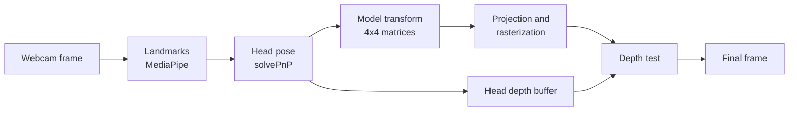

# Mirror Architecture

Technical reference for Mirror's two halves: the live try-on app and the `image_to_3d` model generator. For setup and usage, see the [README](../README.md).

## Contents

- [Live pipeline](#live-pipeline)
- [Coordinate systems](#coordinate-systems)
- [Head-pose estimation](#head-pose-estimation)
- [Occlusion](#occlusion)
- [Mesh renderer](#mesh-renderer)
- [Image to 3D](#image-to-3d)
- [Appearance from the photo](#appearance-from-the-photo)
- [GLB format](#glb-format)
- [Generator options](#generator-options)
- [Validation and performance](#validation-and-performance)
- [Detailed limitations](#detailed-limitations)

## Live pipeline



The frame is mirrored, then MediaPipe Face Mesh returns 478 landmarks. Head pose is computed only when something uses it: the 3D glasses, the axis overlay, or the debug panel. Static data, such as the model, its render arrays and the attachment matrix, is built once. Only the head pose changes per frame.

| Module | Responsibility |
|---|---|
| `main.py` | App loop, command line, keyboard controls, debug panel |
| `head_pose.py` | Camera model, `solvePnP`, Euler angles, axis overlay |
| `accessory_transform.py` | Attachment matrices and pinhole projection for any accessory |
| `glasses_3d.py` | Procedural wireframe glasses and line renderer |
| `glasses.py`, `geometry.py` | 2D overlay and 2D helpers |
| `occlusion.py` | Head proxy, NumPy rasterizer, depth buffer |
| `glb_model.py` | GLB loading, validation, caching, render arrays, texture pyramids |
| `mesh_renderer.py` | Filled, lit, textured triangle renderer |
| `fit_controls.py` | Live fit adjustments |

## Coordinate systems

```
accessory-local (cm) --attachment + fit--> face-local (cm) --head pose--> camera (cm) --pinhole--> pixels
```

- **Accessory-local and face-local** axes are the same: X towards the screen-right lens, Y up, Z out of the face. Units are cm. These match glTF, so GLB files need only metres → centimetres.
- **Camera** uses OpenCV axes: X right, Y down, Z forward.
- **Attachment.** The model's origin, the centre of the frame front, is anchored at the nose bridge (landmark 168), 0.6 cm lower and 0.5 cm forward. That offset was calibrated for the wireframe. Fit adjustments (scale, offsets, yaw, pitch, roll) are composed into the same matrix and never change the mesh.
- **Projection** is `x = f·X/Z + cx`, `y = f·Y/Z + cy`. The focal length is estimated from the frame width because webcams are uncalibrated. Points closer than 1 cm are not projected.
- "Left" and "right" always mean screen-left and screen-right, since the frame is mirrored.

## Head-pose estimation

`cv2.solvePnP` matches ten stable landmarks to MediaPipe's canonical 3D face: eye corners, nose bridge, nose tip, nostrils and forehead. The mouth, chin and eyelids are excluded because they move when talking or blinking. A pose is rejected if its mean reprojection error is too large relative to the face's size on screen. Pose is not smoothed between frames.

## Occlusion

MediaPipe's canonical face mesh (468 vertices, 898 triangles) covers only the front of the face. `occlusion.py` extends its outline backwards into a head proxy: a ring at the ear plane (Z = −6 cm), a narrower ring at the back (Z = −12 cm), and a cap. It has no ears or hair.

Each frame, the proxy is posed with the same head pose as the glasses and rasterized into a 320 px wide depth buffer. The rasterizer is vectorized NumPy. It builds every triangle's per-row pixel spans at once, then tests candidates with barycentric weights. Depth is interpolated perspective-correctly, because 1/Z is linear on screen. Glasses geometry more than 0.5 cm behind the head surface is hidden; that tolerance allows for parts resting on the skin.

The wireframe samples each edge every 2.5 mm and depth-tests the samples. The mesh renderer depth-tests each pixel.

## Mesh renderer

Per frame, `mesh_renderer.py`:

1. Transforms corners and normals to camera space.
2. Clips triangles against the near plane, interpolating normals and UVs along cut edges.
3. Projects, culls back faces, and rasterizes into a depth buffer covering only the model's bounding box, using `occlusion.py`'s rasterizer.
4. Discards pixels behind the head depth buffer.
5. Shades only the visible pixels, with interpolated normals.
6. Softens edges with a 3×3 coverage filter and blends the result into the frame.

**Lighting:** ambient plus diffuse from a fixed light above the camera, with a Blinn-Phong highlight scaled by gloss (1 − roughness). It is tuned so a surface facing the camera keeps roughly its texture colour (factor ≈ 0.98). Shading works in sRGB values directly. Normals are smoothed across edges under 35° and stay sharp elsewhere.

**Textures:** UVs are interpolated with the same perspective-correct weights as normals, so textures don't slide as the head turns. Each texture is stored as a pyramid of halved copies, built once at load. Each frame, the renderer picks the level where one texel covers about one pixel and blends the two nearest levels, so fine patterns average instead of shimmering. Sampling is bilinear, via `cv2.remap`.

**Cost control:** a model wider than 420 px on screen is rasterized at 420 px and scaled up. This bounds cost at any resolution or distance, at the price of slightly softer glasses.

## Image to 3D

`image_to_3d` converts a frontal PNG or JPG of glasses on a white or transparent background into a GLB. It is deterministic and uses no machine learning, depth estimation or network services: the same input and options give a byte-identical file. It imports nothing from the live app.

| Part | Source |
|---|---|
| Frame outline and lens openings | The photo |
| Hinge and nose-pad positions, bridge if present | Estimated from the outline |
| Overall size | `--frame-width`; one image has no absolute scale |
| Depth, wrap curvature, temples, hinge and pad shapes | Procedural |
| Front colours and patterns | The photo, as a texture |
| Side, back, temple and hinge colours | Estimated from the photo |
| Roughness, metalness, pad colour | Settings |

**How the parts are built:**

- **Silhouette.** OpenCV segmentation separates the frame from a white or transparent background. With `--complete`, the white threshold adapts to halfway between the frame and white, which rejects faint drop shadows. `findContours` traces the outline and its holes into polygons at a 1024 px working size. Each lens opening is morphologically closed on its own. That removes strips such as temples seen through a lens, but can't erode a rim, because a rim's far side isn't part of the opening.
- **Curved front.** The outline is extruded with constrained Delaunay caps, which avoid the zero-area triangles that pixel-aligned outlines produce with ear clipping. It is then sheared along Z by `−depth·(x / half_width)²`. A shear keeps X and Y, so the front view stays exactly the traced outline, and it can't fold the surface. Faces are split at planes of constant X, spaced so the curve deviates by at most 0.05 mm.
- **Temples.** The centreline is two cubic Béziers sharing a tangent at the ear bend. Its reach is scaled so the arc length matches `--temple-length`. A rounded-rectangle section is swept along it with rotation-minimising frames, so it doesn't twist. The left temple is the mirror image of the right.
- **Hinges and nose supports.** Hinges are a cylinder and a connecting block anchored at the frame's outer edge. The nose rests on the photographed bridge; a Bézier bridge is generated only when the rims aren't joined. Nose pads are optional ellipsoids.
- **Validation.** Before export, every part is checked for non-finite vertices, degenerate triangles, non-manifold edges, inconsistent winding and inward normals. Joined parts must touch, other pairs must not intersect, and the frame and temples must not intersect themselves.

| Module (`image_to_3d/`) | Responsibility |
|---|---|
| `segmentation.py` | Image loading, background separation, opening cleanup |
| `mesh.py` | Polygon tracing, pixel ↔ cm mapping, flat extrusion, GLB writing |
| `curvature.py` | Wrap curve and curved front frame |
| `sweep.py`, `temples.py` | Béziers, swept tubes, temples |
| `hinges.py` | Hinges, nose pads, fallback bridge |
| `validation.py` | Topology and intersection checks |
| `appearance.py` | Texture, UVs, estimated colours and materials |
| `assembly.py` | Assembling parts and exporting the GLB |
| `pipeline.py`, `mirror_image_to_3d.py` | Conversions and the command line |

## Appearance from the photo

- **Texture.** The photo is cropped to the frame. Pixels within 2 px of the silhouette blend frame and background, so they aren't trusted. Every other texel, including background and lens openings, takes the nearest trusted pixel's colour, via OpenCV's labelled distance transform. Texture filtering therefore never reaches the background, white or transparent. Photographed highlights, shadows and patterns stay on the front as photographed; one photo can't separate lighting from material.
- **Unseen surfaces.** The texture has a second half, holding a copy with CIELAB lightness capped at the frame's 75th percentile, with hue and chroma unchanged. Side walls and the back sample this copy at the same X and Y as the front. Patterns therefore continue around edges without stretching photographed reflections across them.
- **UVs.** Generation already maps photo pixels to centimetres: crop, scale to the working size, then centre and scale with Y flipped. UVs invert that mapping from each vertex's X and Y. Curvature changes only Z, so UVs don't depend on it, and the front isn't rebuilt for texturing. Faces with normal Z above 0.5 use the photo half. Vertices are split only where the two halves meet, so the front surface has no seams.
- **Estimated colours.** The frame colour is the median of the flattened copy over trusted pixels. The temple colour is the same median over the outer 12% of the frame on each side, the end pieces where temples attach. Hinges match the frame unless `--hinge-material metal` is given.

## GLB format

One named node per part: `front_frame`, `left_temple`, `right_temple`, `left_hinge`, `right_hinge`, and optionally `bridge`, `left_nose_pad`, `right_nose_pad`. It is an assembly of closed shells that overlap at joints, not a single watertight solid.

The file is in metres, as glTF specifies. The origin is the centre of the frame front, X runs towards the screen-right lens, Y up, and Z forward. `front_frame` carries UVs and its texture embedded as a PNG in the binary buffer, so the file works without the original photo. Every part has its own PBR material. Blender imports it with the texture correctly oriented. No smooth normals are exported.

## Generator options

Lengths are in cm. Invalid values exit with an error and write nothing. Options in the second group require `--complete`.

| Option | Default | Meaning |
|---|---|---|
| `--demo` | | Generate and convert a sample image |
| `-o`, `--output` | image path with `.glb` | Output file |
| `--frame-width` | 14.0 | Outer edge to outer edge |
| `--frame-thickness` | 0.4 | Front to rear depth |
| `--white-threshold` | 240 | Background if every channel is at or above this (adapts with `--complete`) |
| `--alpha-threshold` | 200 | Background if alpha is below this |
| `--complete` | off | Build the full textured model |
| `--frame-curvature` | 0.5 | How far the outer edges sit behind the centre |
| `--temple-length` | 14.0 | Hinge to tip, along the arm |
| `--temple-width`, `--temple-thickness` | 0.55, 0.25 | Arm cross-section |
| `--temple-splay`, `--temple-curvature`, `--temple-ear-drop` | 1.6, 0.4, 1.5 | Outward offset, inward curl, and drop at the ear |
| `--left-temple-*`, `--right-temple-*` | | Per-arm overrides |
| `--nose-pads` | off | Add nose pads |
| `--opening-cleanup` | 0.04 | Remove strips narrower than this fraction of the width from openings |
| `--no-texture` | off | Fixed materials instead of the photo texture |
| `--hinge-material` | `match` | `match` the frame colour, or `metal` |
| `--frame-roughness` | 0.6 | 0 glossy, 1 matte; a setting, not measured |

## Validation and performance

`validate_appearance.py` regenerates a photo's model with and without texture. It renders the front view at the photo's exact scale, plus three-quarter and side views on the head proxy, into `image_to_3d/output/inspection/appearance/`. It reports two metrics:

- **Silhouette IoU:** overlap of the rendered frame with the photo's mask.
- **ΔE76:** CIELAB colour distance, over frame pixels at least 3 px inside both outlines.

Both measure agreement with one photo under Mirror's lighting, not photorealism.

| Input | Model | IoU | Mean ΔE76 | 95th percentile |
|---|---|---|---|---|
| `glasses.jpg` | textured | 0.947 | 2.2 | 6.2 |
| `glasses.jpg` | untextured | 0.947 | 8.7 | 14.3 |
| `glasses.jpg` with a synthetic tortoiseshell pattern | textured | 0.947 | 2.3 | 5.1 |
| same | untextured | 0.947 | 39.2 | 68.8 |

The tortoiseshell input was made by painting a procedural pattern over the photo's frame pixels, as a demonstration of pattern transfer. It is not a real product.

**Performance**, in median milliseconds. Measured on the development Mac under heavy background load (load average 5–9), with a synthetic moving head and real MediaPipe, not a webcam. The face is at 45 cm, using the textured `glasses.jpg` model (3,008 triangles, 987×650 texture).

| Frame size | Head depth buffer | Mesh render | Whole loop |
|---|---|---|---|
| 640×480 | 8 | 18 | 39 ms (26 fps) |
| 1280×720 | 8 | 33 | 62 ms (16 fps) |
| 1920×1080 | 9 | 39 | not measured |

Texturing adds about 10% to the mesh render. The wireframe renders in about 2 ms. Loading a model, including render arrays and the texture pyramid, takes about 75 ms once; later loads reuse the cache.

## Detailed limitations

- **Geometry is estimated.** Only the outline comes from the photo. Depth, curvature, temples and hinges are parametric defaults. The front is a uniform-thickness sheet with square edges.
- **Input requirements.** Photos must be frontal, with a white or transparent background. Dark lenses become solid, and white frames on white can't be separated. Opening cleanup can remove thin real details.
- **Appearance.** Photographed lighting is baked into the front texture. Edge highlights brighter than the background threshold are lost with the background. Unseen surfaces are estimates, and the temples are a single colour.
- **Fit and tracking.** The focal length is estimated, pose is solved against an average face, and there's no smoothing between frames. All models share one attachment offset, and fits aren't saved with a model.
- **Occlusion.** The head proxy has no ears or hair. The 320 px depth buffer makes temple cut-off lines slightly blocky at high resolutions.
- **Rendering.** No lenses or transparency, no gamma-correct lighting, and a fixed light.
